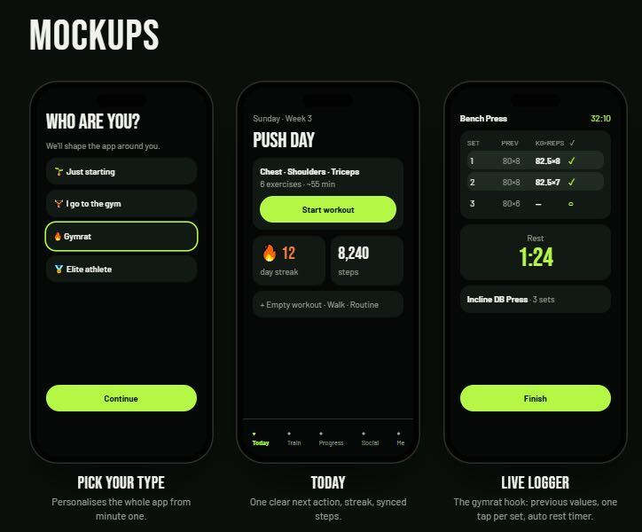
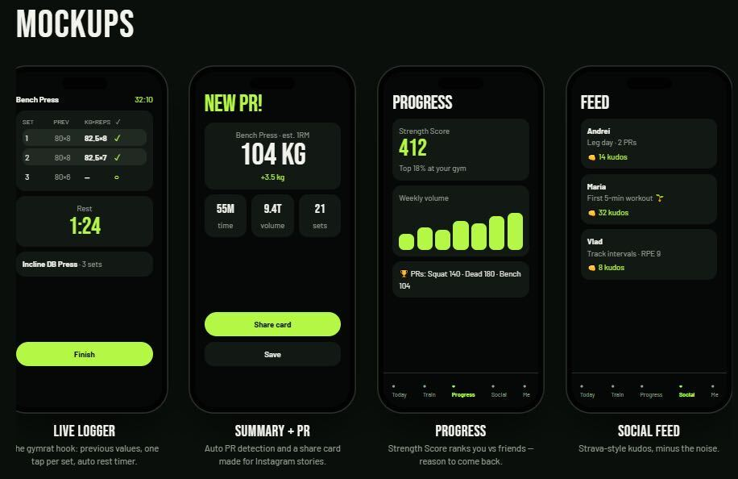

# Mova

**Move. Log. Progress.**

Mova is a mobile fitness app for iOS, Android, and web, built with Flutter. It gives you a plan, makes workout logging fast, and shows honest progress from the data you log.

> Status: pre-implementation. Design and product documentation are complete. The app currently runs the default Flutter scaffold.

Android and iOS are the primary platforms. Web is a companion build that must compile and pass a manual smoke test; full parity is not required.

---

## Why Mova

Most fitness apps either tell you what to do or let you log what you did. Mova does both around one loop:

```text
Set a goal -> Get a training plan -> Complete a workout -> Track progress -> Come back and improve
```

The product bet is simple: the workout logger is the feature people touch every session, so it gets the most attention. Fast set logging, remembered weights, a reliable rest timer, and safe session recovery matter more than a social feed or a leaderboard.

---

## Screens

| | |
|---|---|
|  |  |

The canonical interactive storyboard is [`MOCK.html`](MOCK.html). Open it in a browser to view all 19 screens in one horizontal flow: Splash, the 11-screen onboarding, and the five-tab core loop.

---

## Scope

### Shipping in the MVP

| Area | Features |
|---|---|
| Onboarding | Splash, welcome, units, gender, birth date, weight, height, goals, experience, weekly schedule, notification permission, plan preview |
| Today | Planned workout, start or resume, streak, steps, empty workout, walk, saved routine |
| Train | Exercise library, search, muscle and equipment filters, exercise details, routine list, routine builder |
| Logger | Previous values, set logging, weight and reps, rest timer, add or remove sets, up next, pause, resume, discard protection |
| Summary | Duration, volume, sets, PR detection, estimated 1RM, share card, save |
| Progress | Lifetime totals (workouts, volume, streak), strength score (beta), weekly volume, personal records, workout history, workout detail, body weight entry |
| Social | Local feed, own workout posts, kudos, PR card preview |
| Me | Profile, lifetime stats, units, reminders, integrations, privacy, local data controls, legal and licenses |

### Next after 1.0

- 1:1 share card variant
- Editable exercise notes and per-exercise history charts
- CSV export
- Deeper health insights beyond step counts

### Post-MVP

- Google and Apple Sign-In, accounts, and cloud sync
- Networked social graph, friends, following
- Comments and direct messages
- Gym rankings and leaderboards
- Nutrition and calorie tracking
- GPS run, walk, and ride tracking
- AI-generated plans
- Apple Watch and Wear OS apps
- Light theme

---

## Product decisions

- **Five tabs.** Today, Train, Progress, Social, and Me. The live logger is a full-screen route and hides the tab bar.
- **Mobile first.** Android and iOS are primary. Web builds and smoke tests, but does not require full parity.
- **Local-first.** All data is stored on the device with `shared_preferences`. No backend, no Firebase, no account required.
- **Guest profile.** Onboarding creates a local profile. Google and Apple Sign-In, accounts, and cloud sync are post-MVP and do not change the local data model.
- **Dark only.** Every mockup is dark. The token layer is structured for a light theme later.
- **Honest metrics.** The strength score is labeled beta and does not claim a gym or global ranking, because a local-only app has no comparative dataset.
- **Local social.** The feed contains sample activity and the user's own workouts. Kudos are stored locally. It is motivation, not a network.
- **Manual fallback.** Steps can be entered manually when a health integration is unavailable, so Today never depends on a permission.

Read the full design system in [`DESIGN.md`](DESIGN.md).

---

## Tech stack

| Layer | Choice |
|---|---|
| Framework | Flutter and Dart |
| State management | Provider (`ChangeNotifier`) |
| Storage | `shared_preferences`, JSON payloads with `schemaVersion` |
| Navigation | Named routes in `lib/navigation/` |
| Backend | None |
| Auth | Local guest profile in v1; Google and Apple Sign-In post-MVP |
| Firebase | Not used |
| Design | Dark theme, lime accent, Material 3 foundations |

Minimum Dart SDK is declared in [`pubspec.yaml`](pubspec.yaml).

---

## Architecture

```text
lib/
  main.dart                 // Entry point, provider wiring
  app.dart                  // MaterialApp, theme, routes
  app_coordinator.dart      // Transactions across providers
  common/                   // Formatters, constants, small helpers
  models/                   // UserProfile, Exercise, Workout, Routine, PR, Post
  navigation/               // Route names and route table
  providers/                // Profile, plan, workout, history, social, settings
  screens/                  // One folder per feature
  services/                 // Storage, seed data, plan generation, PR, share
  theme/                    // Colors, typography, spacing, radii, ThemeData
  widgets/                  // One public widget per file
assets/
  data/                     // Seed exercise library
  fonts/                    // Bundled Barlow Condensed and Inter
  icons/
  images/
  legal/
  svgs/
store/                      // Store listing assets and notes
tool/                       // Local verification scripts
test/
```

### Conventions

- One model, provider, service, widget, or screen per file.
- Widgets never hardcode colors, type sizes, radii, or spacing. Read from `lib/theme/`.
- `build()` is the last method in a class. Widget-returning helpers are named `_build...` and sit above it.
- Canonical units are kilograms, centimeters, and seconds. Conversion happens at display time.
- Every stored payload carries a `schemaVersion`.
- Corrupt local data falls back to a safe default and never crashes the app.
- No em dashes in code, comments, or copy. Hyphens only.

### Key data rules

- Volume: `sum(weight_kg * reps)` for completed weighted sets.
- Estimated 1RM: Epley, `weight * (1 + reps / 30)`, for sets of 1 to 12 reps.
- PR: strictly higher estimated 1RM, or higher reps for bodyweight movements, from completed working sets.
- Streak: consecutive local calendar days with a completed workout or logged walk.
- Strength score: average of best lift to bodyweight ratios across tracked lifts. Requires at least three sessions and two tracked lifts. Labeled beta and unranked.

---

## Getting started

Requirements: macOS with the Flutter SDK matching `pubspec.yaml`, plus Xcode for iOS or the Android SDK for Android.

```bash
flutter pub get
flutter run
```

Web smoke test:

```bash
flutter run -d chrome
```

Web is a smoke-tested companion build. Verify onboarding, Today, and one logged set. Health, notifications, and native sharing may degrade or hide.

Useful commands:

```bash
flutter analyze
flutter test
flutter build apk --debug
```

---

## Quality gates

Work is not complete until all three pass:

1. `flutter analyze` reports zero issues.
2. `flutter test` is green.
3. `flutter build apk --debug` succeeds.

Release work adds a fourth gate:

4. `flutter build web --release` succeeds and QA scenario P passes in Chrome on macOS.

Docs-only changes still run `flutter analyze` and `flutter test` before they are called complete.

---

## Roadmap

| Phase | Deliverables |
|---|---|
| Phase 0 Docs and definitions | `DESIGN.md`, `README.md`, scope, decisions, definitions |
| Phase 1 Foundation | Theme tokens, models, storage, seed exercises, app shell, onboarding, plan generation, Today |
| Phase 2 Core training | Train library, exercise details, routines, builder, live logger, rest timer, resume and discard, summary, PR detection |
| Phase 3 Progress | Dashboard, lifetime totals, PR wall, weekly volume, streak, strength score, workout history, body weight |
| Phase 4 Social | Local feed, own workout posts, kudos, PR share cards |
| Phase 5 Completion | Me and settings, units, reminders, health fallback and plugin, empty states, accessibility, legal |
| Phase 6 Hardening and QA | Device tests, accessibility audit, performance, recovery, release builds, store assets |

---

## Documentation

| File | Purpose |
|---|---|
| [`DESIGN.md`](DESIGN.md) | Design system, component specs, screen specs, data rules |
| [`AGENTS.md`](AGENTS.md) | Repository rules, plan reading, conventions |
| [`CHANGELOG.md`](CHANGELOG.md) | Compact completed-work log |
| [`plans/`](plans/) | Active plans, one file per plan |
| [`resources/`](resources/) | Mockups, screen tree, product review |

Plans are named `YYYY.MM.DD.<slug>.md`. A plan is done only when its completed work is recorded in `CHANGELOG.md`.

---

## Non-goals for v1

- Competing with social networks
- Ranking users against each other
- Tracking food or calories
- Tracking GPS routes
- Generating plans with AI
- Running without a local profile
- Depending on a network connection to open the app

---

## License

License is not decided yet. Treat the repository as private until a license is added.
